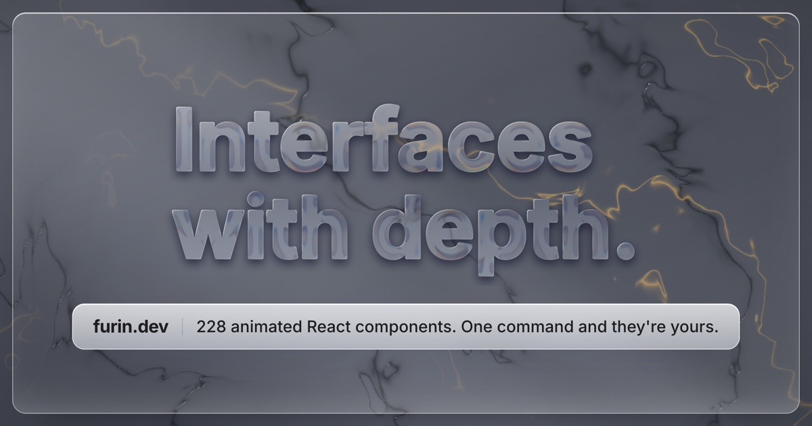

# Furin



92 free animated React components: text effects, living backgrounds, tilt cards, buttons, cursors, navigation and loaders.

- Zero dependencies besides React.
- TypeScript, SSR-safe, works in Next.js, Vite, Remix and Astro.
- Respects `prefers-reduced-motion` and cleans up on unmount.
- MIT license: use them anywhere.

**[See every component live, with controls](https://furin.dev/components/?utm_source=github)**

## Install one component

The code lands in your project, so it is yours to edit.

```bash
npx shadcn@latest add https://furin.dev/r/glass-blobs.json
```

## Or install the package

```bash
npm i furin-ui
```

```tsx
import { Aurora } from "furin-ui";
```

## Components

### Backgrounds

| Component | What it does |
|---|---|
| [Aurora](https://furin.dev/components/aurora/?utm_source=github) | A WebGL background of slowly rippling aurora curtains, in your own colors. |
| [Code Rain](https://furin.dev/components/code-rain/?utm_source=github) | Columns of real JSX and TypeScript snippets falling across three depth planes, with a glowing head and syntax highlighting. |
| [Dither Wave](https://furin.dev/components/dither-wave/?utm_source=github) | A relief of waves drawn with one-bit Bayer ordered dithering. The cursor leaves expanding rings. |
| [Fireflies](https://furin.dev/components/fireflies/?utm_source=github) | Fireflies that drift at three depths and blink with a warm glow; they curiously approach the cursor and circle it. |
| [Galaxy](https://furin.dev/components/galaxy/?utm_source=github) | A spiral galaxy of tens of thousands of particles with a glowing core that rotates slowly; the cursor tilts the view. |
| [Glass Blobs](https://furin.dev/components/glass-blobs/?utm_source=github) | Blobs of color floating behind a sheet of frosted glass. |
| [Grain Mesh](https://furin.dev/components/grain-mesh/?utm_source=github) | A mesh gradient that floats and blends, with fine film grain; the cursor pulls on one of the blobs. |
| [Halftone Field](https://furin.dev/components/halftone-field/?utm_source=github) | A print-style halftone with two overprinted inks: the dots grow and shrink with a flowing field and with the cursor. |
| [Holo Foil](https://furin.dev/components/holo-foil/?utm_source=github) | A holographic background: an iridescent film, a fine diffraction grating and a sheen that shift with the cursor's angle. |
| [Ink Bloom](https://furin.dev/components/ink-bloom/?utm_source=github) | Drops of ink that bloom in dark water with swirls and tendrils, one after another in a cycle. Tap to drop one; move the cursor to stir the water. |
| [Lava Lamp](https://furin.dev/components/lava-lamp/?utm_source=github) | A lava lamp with glass and warm light: the wax rises, stretches, merges with other blobs and splits apart. Your cursor warms it. |
| [Liquid Chrome](https://furin.dev/components/liquid-chrome/?utm_source=github) | A chrome surface that ripples and reflects a luminous environment. |
| [Live Grid](https://furin.dev/components/rejilla-viva/?utm_source=github) | A grid of dots that part and light up around the cursor, on a spring. |
| [Prism Light](https://furin.dev/components/prism-light/?utm_source=github) | A real 3D scene in WebGL2: a glass prism (beveled mesh with fresnel and refraction) on a reflective vinyl floor. A light orb follows your cursor and fires a volumetric beam; the spectrum fans out by Snell's law, one ray per color, and lands on the wall and floor with its caustic. The camera parallaxes with the cursor. |
| [Retro Grid](https://furin.dev/components/retro-grid/?utm_source=github) | A perspective grid that scrolls endlessly toward a horizon with a muted sun; the cursor shifts the horizon and holding down speeds it up. |
| [Ripple Pond](https://furin.dev/components/estanque/?utm_source=github) | A WebGL water surface: the cursor and raindrops leave ripples that cross, catch the light and warp a grid beneath. |
| [Silk Flow](https://furin.dev/components/silk-flow/?utm_source=github) | A silk fabric that ripples slowly, with an anisotropic thread sheen that shifts with the light and follows the cursor. |
| [Smoke Field](https://furin.dev/components/smoke-field/?utm_source=github) | Volumetric smoke with studio lighting that rises endlessly; your cursor parts and swirls it, and the smoke fills the gap back in. |
| [Snowfall](https://furin.dev/components/snowfall/?utm_source=github) | Snow in three layers of depth (far, mid and close bokeh) with a wind that blows toward wherever the cursor is. |
| [Topo Lines](https://furin.dev/components/topo-lines/?utm_source=github) | A living topographic map: contour lines of a slowly deforming terrain, with labeled index contours; the cursor raises a hill. |
| [Warp Stars](https://furin.dev/components/warp-stars/?utm_source=github) | Stars at warp speed with trails and depth; the cursor steers the vanishing point and holding down triggers the jump. |

### Buttons

| Component | What it does |
|---|---|
| [Confetti Button](https://furin.dev/components/confetti-button/?utm_source=github) | A button that fires physical confetti: paper pieces that spin in 3D, fall with air drag and flutter. |
| [Copy Morph](https://furin.dev/components/copy-morph/?utm_source=github) | A copy button where the icon outline morphs into a checkmark with a stroke and spring morph. It really copies the text with navigator.clipboard (with a fallback). |
| [Download Button](https://furin.dev/components/download-button/?utm_source=github) | A button that narrows into a progress bar, advances at an uneven pace like a real network, and ends in a checkmark. With href, it really downloads the file. |
| [Glass Button](https://furin.dev/components/glass-button/?utm_source=github) | A liquid-glass button that refracts the background behind it. |
| [Glint Button](https://furin.dev/components/glint-button/?utm_source=github) | A dark button with a glint that sweeps across it every so often and on hover, lighting up the fill, the border and the text at once. |
| [Hold to Confirm](https://furin.dev/components/hold-to-confirm/?utm_source=github) | Press and hold to confirm: a ring fills, the button shakes more and more, and it vibrates on completion. Works with mouse, touch or keyboard. |
| [Metal Button](https://furin.dev/components/metal-button/?utm_source=github) | A polished metal button with a beveled edge and a reflection that follows the cursor. |
| [Ripple Button](https://furin.dev/components/ripple-button/?utm_source=github) | A button whose ripple is born exactly where you click: a luminous wavefront with rings that sweeps out to the farthest corner. |
| [Slide to Confirm](https://furin.dev/components/slide-to-confirm/?utm_source=github) | A physics-driven handle you drag to the end to confirm; release early and it springs back with a bounce. Accessible as a slider. |

### Cards

| Component | What it does |
|---|---|
| [Bento Light](https://furin.dev/components/bento-light/?utm_source=github) | A six-cell bento grid with a light that jumps between cells, following the cursor (or on its own), and spills onto its neighbors. |
| [Border Beam](https://furin.dev/components/border-beam/?utm_source=github) | A beam of light with a tail, a bright head and a halo that travels around the outline of any content at constant speed. |
| [Card Stack](https://furin.dev/components/card-stack/?utm_source=github) | A deck of cards you shuffle by dragging the top one: inertia, rotation and a spring back to the bottom. Also works with click and keyboard. |
| [Electric Border](https://furin.dev/components/electric-border/?utm_source=github) | Arcs of electricity that snake around the border, with local discharges, sparks and a flickering glow. |
| [Folder Peek](https://furin.dev/components/folder-peek/?utm_source=github) | A cardboard folder that opens on hover and lets its documents peek out with a soft bounce. |
| [Glass Card](https://furin.dev/components/glass-card/?utm_source=github) | Liquid glass with refraction, a specular edge and a reflection that follows the cursor. |
| [Parallax Card](https://furin.dev/components/parallax-card/?utm_source=github) | Real 3D layers (sky, stars, planet, ring, dunes, text and shine) that separate at different depths as the card tilts. |
| [Profile Foil](https://furin.dev/components/profile-foil/?utm_source=github) | A profile card with a holographic foil: it tilts in 3D with the cursor and the iridescence shifts with the angle. |
| [Shine Card](https://furin.dev/components/shine-card/?utm_source=github) | A satin sheen sweeps across the card as the cursor passes over it. |
| [Sticker Peel](https://furin.dev/components/sticker-peel/?utm_source=github) | A glossy die-cut sticker that peels from the corner following the cursor, with curvature, a paper back and a shadow. |
| [Ticket Tear](https://furin.dev/components/ticket-tear/?utm_source=github) | A paper ticket with a perforation: drag the stub and it tears from top to bottom, with a fibrous edge and a shadow that grows as it peels away. |
| [Titanium Card](https://furin.dev/components/metal-card/?utm_source=github) | A brushed-titanium card whose reflection shifts as it tilts. |

### Cursors

| Component | What it does |
|---|---|
| [Click Burst](https://furin.dev/components/click-burst/?utm_source=github) | Fine rays that burst out where you click: they travel outward, detach from their origin and leave a ring and tiny sparks. |
| [Crosshair](https://furin.dev/components/crosshair/?utm_source=github) | A precision crosshair: edge-to-edge lines with a center gap, rulers with tick marks along the edges and live monospace coordinates. |
| [Goo Cursor](https://furin.dev/components/goo-cursor/?utm_source=github) | A translucent jelly cursor with a specular highlight: it drags droplets behind it that stretch into a trail and melt back into it when you stop. |
| [Ink Trail](https://furin.dev/components/ink-trail/?utm_source=github) | A glossy ink trail that follows the cursor, widens as if bleeding into paper, and frays into strands until it fades away. |
| [Lens Cursor](https://furin.dev/components/lens-cursor/?utm_source=github) | A glass magnifier that enlarges whatever is underneath it. |
| [Ring Cursor](https://furin.dev/components/ring-cursor/?utm_source=github) | A ring that follows the cursor with an elastic lag, stretches with speed and, over anything clickable, morphs into its outline like a soft magnet. |
| [Spark Trail](https://furin.dev/components/spark-trail/?utm_source=github) | The cursor sheds sparks with real physics: they inherit its momentum, fall under gravity, bounce on the floor and cool from white to ember. |

### Data

| Component | What it does |
|---|---|
| [Analog Gauge](https://furin.dev/components/analog-gauge/?utm_source=github) | An analog gauge whose needle swings and settles on its value, with a printed dial and a red zone. |

### Galleries

| Component | What it does |
|---|---|
| [Coverflow](https://furin.dev/components/coverflow/?utm_source=github) | Album covers in perspective with reflections: the center one faces you and the rest fan out. Arrows, drag with inertia, click and keyboard. |
| [Masonry Reveal](https://furin.dev/components/masonry-reveal/?utm_source=github) | A column masonry grid that appears piece by piece as it scrolls into view, with a soft bounce and a flash; hovering a piece zooms it in and shows its title. |
| [Orbit Gallery](https://furin.dev/components/orbit-gallery/?utm_source=github) | Cards with generated scenes on a 3D circular carousel: it spins on its own, drags with inertia, and a click brings a card to the front. |
| [Photo Stack](https://furin.dev/components/photo-stack/?utm_source=github) | A stack of printed photos that fans out when you hover; a click sends the top one to the back. |

### Interaction

| Component | What it does |
|---|---|
| [Holo Card](https://furin.dev/components/holograma/?utm_source=github) | A card with 3D tilt and an iridescent holographic foil that follows the cursor. |
| [Magnet](https://furin.dev/components/iman/?utm_source=github) | Wrap any element and it gets pulled toward the cursor with spring physics. |
| [Red Thread](https://furin.dev/components/hilo-rojo/?utm_source=github) | The red thread of fate: a thread with Verlet physics that follows the cursor, pulls taut against its anchor and swings. |
| [Spotlight Cards](https://furin.dev/components/reflector/?utm_source=github) | A grid of cards whose borders light up wherever the cursor passes, driven by a single shared light. |
| [Wind Chime](https://furin.dev/components/campana/?utm_source=github) | A glass furin wind chime that sways with the cursor's breeze and rings when touched. It doubles as a notification bell with a counter. |

### Loaders

| Component | What it does |
|---|---|
| [Liquid Fill](https://furin.dev/components/liquid-fill/?utm_source=github) | A glass flask that fills with liquid. |
| [Morph Loader](https://furin.dev/components/morph-loader/?utm_source=github) | A glossy gradient shape that smoothly morphs between circle, square and triangle, spinning and squashing slightly on each change. |
| [Typing Indicator](https://furin.dev/components/typing-indicator/?utm_source=github) | A "typing…" bubble with three elastically bouncing dots that, in a loop, turns into the reply with a little spring. |

### Navigation

| Component | What it does |
|---|---|
| [Dock](https://furin.dev/components/dock/?utm_source=github) | A bar of icons that magnify under the cursor, on glass. |
| [Elastic Slider](https://furin.dev/components/elastic-slider/?utm_source=github) | A slider (role slider, full keyboard support) that stretches like rubber when dragged past its limits and snaps back with a bounce; the track squashes to preserve volume. |
| [Glass Segmented Control](https://furin.dev/components/glass-segmented/?utm_source=github) | A glass segmented control with a lens that slides between options. |
| [Gooey Tabs](https://furin.dev/components/gooey-tabs/?utm_source=github) | Accessible tabs whose selection is a blob of liquid: it stretches toward the new tab, thins at the neck and merges when it arrives. |
| [Marquee](https://furin.dev/components/marquee/?utm_source=github) | A seamless infinite marquee: the cursor slows it down and nudges it with inertia, rows run in opposite directions, and keyboard focus pauses it. |
| [Metal Knob](https://furin.dev/components/metal-knob/?utm_source=github) | A knurled metal knob you turn by dragging. |
| [Pill Nav](https://furin.dev/components/pill-nav/?utm_source=github) | Accessible tabs (tablist, arrow keys, Home and End) with a pill that slides on a spring: the leading edge arrives first and stretches the pill as it crosses. |
| [Spring Accordion](https://furin.dev/components/spring-accordion/?utm_source=github) | An accessible accordion (aria-expanded, regions, arrow keys, Home and End) whose regions open on a real spring: the height bounces as it lands and the content comes in from blurry to sharp. |
| [Spring Tooltip](https://furin.dev/components/spring-tooltip/?utm_source=github) | A tooltip (role tooltip) that follows the cursor on a spring and hangs from it like a tag: it tilts with speed and stretches a little as it moves. It also appears on keyboard focus. |
| [Stepper](https://furin.dev/components/stepper/?utm_source=github) | Steps with a progress line that fills from one node to the next; the new step lights up as the stroke arrives and the checkmark draws itself on completion. |
| [Toast Stack](https://furin.dev/components/toast-stack/?utm_source=github) | Notifications stacked like cards: they fan out on hover or focus, pause while you read them, close on their own and are announced with aria-live. |

### Text

| Component | What it does |
|---|---|
| [ASCII Text](https://furin.dev/components/ascii-text/?utm_source=github) | Text drawn with ASCII characters. A lens around the cursor magnifies, rotates and scrambles them. |
| [Blur Number](https://furin.dev/components/blur-number/?utm_source=github) | A number whose digits roll to the new value with vertical motion blur, one after another. |
| [Chrome Text](https://furin.dev/components/chrome-text/?utm_source=github) | Liquid chrome letters whose reflection follows the cursor. |
| [Decipher Text](https://furin.dev/components/descifrar/?utm_source=github) | Text that appears by deciphering itself: random characters settle into place letter by letter. |
| [Gold Foil Text](https://furin.dev/components/gold-foil-text/?utm_source=github) | Gold foil text with relief and a specular glint as you move the cursor. |
| [Gust](https://furin.dev/components/rafaga/?utm_source=github) | A headline whose letters get swept away by the cursor's wind like leaves, then spring back into place. |
| [Magnetic Letters](https://furin.dev/components/magnetic-letters/?utm_source=github) | Every letter is pulled toward the cursor by a bouncy spring, tinting and growing as it gets close. |
| [Mask Reveal](https://furin.dev/components/mask-reveal/?utm_source=github) | Staggered lines that slide up from behind a mask, like a product launch intro. |
| [Morph Text](https://furin.dev/components/morph-text/?utm_source=github) | Words melt into one another with a viscous blur-and-threshold transition and a liquid sheen. |
| [Odometer](https://furin.dev/components/odometro/?utm_source=github) | Numbers that roll digit by digit up to their value, like a mechanical odometer. |
| [Orbit Text](https://furin.dev/components/orbit-text/?utm_source=github) | Text on a circle that turns slowly and speeds up, with inertia, when the cursor gets close. |
| [Outline Fill](https://furin.dev/components/outline-fill/?utm_source=github) | Outlined text that fills with liquid through a wave that starts where the cursor enters, and drains when it leaves. |
| [Pixel Assemble](https://furin.dev/components/pixel-assemble/?utm_source=github) | Text assembles itself from a cloud of spring-driven particles; the cursor scatters them and they snap back on their own. |
| [RGB Glitch Text](https://furin.dev/components/rgb-glitch-text/?utm_source=github) | Clean text that occasionally breaks into short bursts: split RGB channels and shifted slices. |
| [Shimmer Sweep](https://furin.dev/components/shimmer-sweep/?utm_source=github) | A satin sheen sweeps across the text like light over aluminum. |
| [Split-Flap Board](https://furin.dev/components/tablero/?utm_source=github) | A board of flaps that flip in 3D, character by character, until the phrase forms, like at a train station. |
| [Typewriter](https://furin.dev/components/typewriter/?utm_source=github) | Types, deletes and retypes phrases with a human rhythm, pauses on punctuation and a blinking cursor. |
| [Weight Wave](https://furin.dev/components/weight-wave/?utm_source=github) | The weight of a variable font ripples with the cursor's proximity, letter by letter. |
| [Word Roller](https://furin.dev/components/word-roller/?utm_source=github) | A word rolls vertically between options on a spring-loaded drum, and its pill changes width along with it. |

## Furin Pro

This repository holds the free components. [Furin Pro](https://furin.dev/pricing/?utm_source=github) adds 136 more and is sold separately; it is not part of this repository or of its MIT license.

## License

[MIT](LICENSE)
